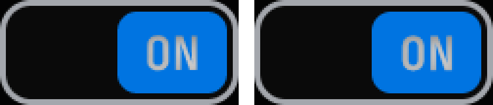
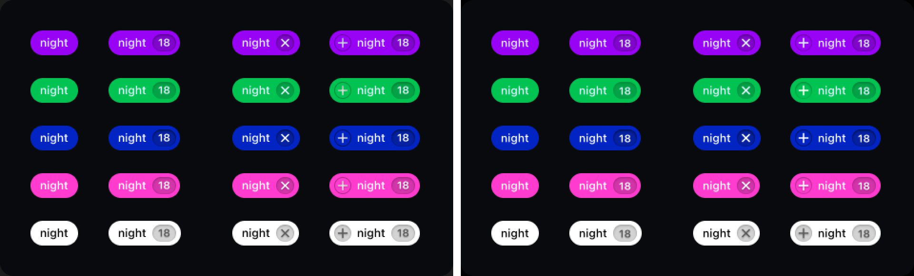
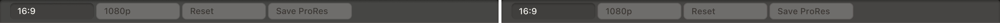

# figleaf

Figma-flavoured paint primitives and auto layout for small native Rust UIs.

You design a control in Figma. An agent (or you) reads the numbers off the
inspector and writes them down as figleaf calls, instead of hand-drawing
rounded rectangles, strokes and shadows again in every app. The host keeps its
own window, event loop, state and render pass; figleaf only answers "where does
this go" and "draw it the way Figma would".


That image is `cargo run --example switch --features wgpu,text-coretext`; its
design is made up for the example.

Three real controls have been checked against Figma so far, all written from
the values Figma reports. In each pair Figma's export is on the left and
figleaf is on the right.

The switch from the Abner design system ([examples/abner_switch.rs](examples/abner_switch.rs)),
enlarged 6x:


The ON/OFF switch from the same file ([examples/abner_onoff.rs](examples/abner_onoff.rs)),
enlarged 4x:



A segmented control from the Abner Timeline file ([examples/full_range.rs](examples/full_range.rs)),
enlarged 3x:


Switchblade's tag pill, all twenty variants
([examples/switchblade_tags.rs](examples/switchblade_tags.rs)), enlarged 2x:



Abner's button bar ([examples/abner_button_bar.rs](examples/abner_button_bar.rs)),
Figma on the left:



Fills, strokes, clips and layout land on the same pixels; shadows are within
4/255; curved edges are antialiased slightly differently; glyph edges differ
because Figma does not rasterize text with CoreText. What has and has not
been checked is in [TASKS.md](TASKS.md).

## Figma plugin

[figleaf → Rust](plugin/README.md) displays copyable Rust for a selected hierarchy.
Import [plugin/manifest.json](plugin/manifest.json) in Figma Desktop's Development
menu. Unsupported features block all output. The plugin has no filesystem or
network access; it exports the current geometry, not responsive layout behavior.

## Paint

```rust
use figleaf::{Canvas, Rect, Shadow, Shape, StrokeAlign, Text, hex, hexa};

let mut canvas = Canvas::new();
// Track: 44x24, corner radius 12, fill #34C759.
canvas.shape(Shape::rect(Rect::new(0., 0., 44., 24.)).radius(12.).fill(hex(0x34C759)));
// Knob: 20x20 ellipse, white, drop shadow X0 Y2 blur 4 at #000 20%.
canvas.shape(
    Shape::ellipse(Rect::new(22., 2., 20., 20.))
        .fill(hex(0xFFFFFF))
        .stroke(0.5, hexa(0x0000000A), StrokeAlign::Outside)
        .shadow(Shadow::drop(hexa(0x00000033), [0., 2.], 4.)),
);
canvas.text(Text::new("Sync to grid", Rect::new(56., 4., 120., 16.)).size(13., 16.));
```

| Figma | figleaf |
| --- | --- |
| Rectangle, corner radius, per-corner radii | `Shape::rect(..).radius(..)` / `.radii([tl, tr, br, bl])` |
| Ellipse | `Shape::ellipse(..)` |
| Fill (solid) | `.fill(hex(0xRRGGBB))`, `hexa(0xRRGGBBAA)` |
| Fill (linear gradient), paint opacity | `.gradient(LinearGradient::transform([a, b, tx]).stop(0., color).stop(1., color).opacity(0.5))` |
| Several fills | call `.fill(..)` / `.gradient(..)` once per fill, bottom first |
| Stroke, inside / center / outside | `.stroke(width, color, StrokeAlign::..)` |
| Individual frame borders, top / right / bottom / left | `.strokes([top, right, bottom, left], color, StrokeAlign::..)` |
| Drop shadow X, Y, blur, spread | `.shadow(Shadow::drop(color, [x, y], blur).spread(s))` |
| "Show behind transparent areas" | `.show_behind()` |
| Inner shadow | `.shadow(Shadow::inner(color, [x, y], blur))` |
| A vector's straight stroke with round caps (icons) | `Shape::line(from, to, width).fill(color)` |
| Clip content on a frame | `.clip(rect)` / `.clip_rounded(rect, radius)` |
| Text, size / line height, alignment | `Text::new(..).size(13., 16.).align(..)` |
| Letter spacing (pixels) | `.letter_spacing(0.7)` |
| Fixed-width text box, line breaks | `.wrap()`; `text::wrap(..)` gives the lines, for the height |
| Inner shadow on text | `.inner_shadow(color, [x, y], blur)` |
| Drop shadow on text | `.drop_shadow(color, [x, y], blur)` |

figleaf draws a text field's look but does not edit text. For the host's
caret and selection, `text::caret_offsets(backend, string, style)` gives the
distance from the start of the line to each place a caret can stand.

Colours are straight-alpha encoded sRGB, the numbers Figma shows.

Individual borders use one continuous ring with elliptical corner contours,
including zero-width sides. `cargo run --example frame_borders --features wgpu`
renders synthetic rounded cases. Abner's button-bar example now uses a real
bottom border and was reviewed beside its saved Figma export; unequal rounded
border widths have synthetic validation only. No new dependencies were added.

## Affine transforms

`Shape::transform` and `Text::transform` take Figma's two matrix rows:
`Transform::new([[a, c, tx], [b, d, ty]])`. Geometry, borders, gradients and
supported effects stay in local coordinates. `parent.compose(child)` applies
the child first, then the parent. Rotation, reflection, nonuniform scale and
skew work on primitives, filled paths and text; singular/non-finite matrices
are reported in `Renderer::problems`.

Plain `.clip(...)` remains in canvas coordinates. Use
`Shape::clip_transformed(rect, radius, ancestor_transform)` or
`Text::clip_transformed(rect, ancestor_transform)` for an ancestor's local clip.
The plugin composes nested matrices and omits only the selection root's
translation. Crossing independently transformed clips and rounded text clips
still fail closed; complete clip intersections are a separate task.

Run `cargo run --example affine --features wgpu` for rotation/reflection/skew
beside Figma ([comparison](docs/affine-compare.png)): mean difference 0.23/255,
maximum 78/255 at an edge. Nonuniform scale, transformed text/effects, nested
composition and cache behavior have synthetic tests. Text rasterizes at the
maximum magnification, within the existing backend limits (including 4× scale),
and samples its transformed mask with bilinear filtering. No new dependencies;
GPU storage adds 64 bytes per shape and 64 per text instance.

## Vector paths

`Shape::vector(rect, paths)` paints local-coordinate `VectorPath` regions with
solid/linear-gradient fills and the existing rectangular/rounded clips. Paths
have `move_to`, `line_to`, `quadratic_to`, `cubic_to`, and `close` builders.
`WindingRule::NonZero` and `EvenOdd` preserve holes; `None` preserves explicitly
unfilled network branches. Open filled contours close implicitly. Regions are
unioned before each fill, so overlaps do not accumulate opacity.

The plugin reads Figma's resolved `fillGeometry` plus unfilled `vectorPaths`.
Path effects and per-region paint overrides remain hard errors. Solid path
strokes are supported as described below. Run `cargo run --example vector_paths --features wgpu` for the person
icon from [Switchblade's design](https://www.figma.com/design/p01oYypZrTOjxe4Pi2Ytxe?node-id=336-1230).
Its bound color was explicitly resolved for the saved fixture. The plugin now resolves bindings in the consumer’s active
mode and records their provenance in comments. Figma's 4× export is left, generated Rust's render right:


Reviewed at 4×: mean channel difference 0.82/255, maximum 29/255 at an edge.
Other winding/curve cases have synthetic tests. No new dependencies: the CPU
subdivides curves to 0.125 physical-pixel tolerance and the GPU uses 4×4 coverage
samples. This is intended for small UI vectors, not large illustrations. Limits
are 256 regions, 4,096 commands, 8,192 subdivided edges per shape, and 32 MiB of
scene edge storage (or the device limit). A shape exceeding 512 million estimated
edge/sample checks is reported in `Renderer::problems`, as are invalid paths
and unsupported styles. Unchanged geometry uploads nothing. `Layer` now borrows
its source vector paths; hosts consuming layers must retain the source shapes.

## Path strokes

Vectors accept `.stroke(width, color, StrokeAlign::Inside/Center/Outside)`,
`.stroke_cap(StrokeCap::Butt/Square/Round)`,
`.stroke_join(StrokeJoin::Miter/Bevel/Round)`, and `.stroke_miter_limit(ratio)`
(the SVG ratio, default 4, minimum 1). Closed contours use their winding rules
for inside/outside alignment, including holes; open contours use centered strokes.
Strokes are formed in local coordinates before affine transformation. Overlaps
within one stroke are unioned before applying opacity. Fill and stroke remain
separate paints. `stroke_paths(paths)` supplies independent centerlines for a
network whose resolved filled regions differ from its stroked edges.

The plugin traces non-branching vector networks exactly once and exports native
stroke calls, including curved segments. Branches, isolated network vertices,
per-vertex join overrides, rounded vector vertices and variable-width strokes
remain hard errors. Endpoint overrides and dashes are supported below. Path effects remain unsupported.

`cargo run --example path_strokes --features wgpu` renders generated plugin code
beside Figma's 2× export ([comparison](docs/path-strokes-compare.png)): curved caps,
acute joins, thick aligned strokes and holes; mean channel difference 0.07/255,
maximum 72/255 at an edge. Miter-limit changes, zero-length round/square caps,
transforms, clipping, alpha and caching also have synthetic GPU tests.

The optional `wgpu` feature now includes `tiny-skia-path` 0.11.4 for curve
stroking, adding three crates (`tiny-skia-path`, `strict-num`, `arrayref`), about
280 KiB of installed Rust source. Linked size depends on the host's build.
Default builds still have no dependencies. Stroke expansion shares the existing
4,096-command / 8,192-edge and GPU work limits; exceeding them reports a problem
rather than omitting part of a shape.

## Dashes and endpoints

`.dash_pattern(vec![12., 8.])` accepts Figma's alternating dash/gap lengths.
Patterns fit each segment with a dash centered on its vertices; adjacent pieces
join across corners. Odd sequences repeat; zero entries follow Figma's evaluated
pattern behavior, and empty/all-zero patterns draw solid strokes. Curves remain
curves throughout dash splitting. Rectangles (including rounded corners), ellipses,
and vector paths support dashed uniform strokes. Unequal dashed borders, dashed
effects, and dashes on the legacy `Shape::line` helper produce errors; use a
stroked `Shape::vector` for dashed lines, as the plugin does.

`StrokeCap` also has `ArrowLines`, `ArrowEquilateral`, `TriangleFilled`,
`DiamondFilled`, and `CircleFilled`. Set a node-wide cap with `.stroke_cap(...)`,
or override each open path's endpoints with `VectorPath::start_cap(...)` and
`end_cap(...)`. Decorations follow endpoint tangents and stroke width before
transforms; triangle shafts are shortened, and decorations are unioned with the
stroke before opacity. Closed contours have joins instead of decorations.

The plugin emits these calls, including different caps at a vector's two ends.
Unsupported/missing endpoint styles, mixed joins, branching networks and brush
strokes still fail closed. A decorated zero-length path reports that it has no
tangent. Patterns allow at most 32 finite, nonnegative entries; dash subdivision
and stroke outlines retain explicit command, region, edge and GPU work limits.

`cargo run --example dashed_endpoints --features wgpu` renders generated code
beside Figma ([comparison](docs/dashed-endpoints-compare.png)): curved dash caps,
aligned closed paths, all five decorations, mixed endpoints and primitive borders.
Mean channel difference is 0.12/255; the largest local difference is 232/255 near
a curved decorated endpoint. Synthetic tests also cover reflected arrows, shaft
trimming, dash phase, opacity, malformed patterns and unchanged-canvas uploads.
No additional dependencies were added for this task.

## Layout

```rust
use figleaf::layout::{Align, Node, Sizing, Tree};

// A row: 12 padding, label left, switch right, centred vertically.
let mut tree = Tree::new(Node::row().padding(12.).align(Align::SpaceBetween, Align::Center));
let label = tree.add(tree.root(), Node::fixed([120., 16.]));
let switch = tree.add(tree.root(), Node::fixed([44., 24.]));

let solved = tree.solve([320., 48.])?;   // on every resize
let where_the_switch_goes = solved[switch];
```

Covers horizontal and vertical auto layout, wrapping (`.wrap(gap_between_lines)`),
padding, gap, alignment including space-between, fixed / hug / fill sizing, min
and max sizes, and absolutely positioned children. `solve_natural` sizes a hugging root to its content. Text
does not measure itself: ask the text backend for the advance and set the node.

## Drawing

With the `wgpu` feature the renderer draws inside the host's own render pass:

```rust
let mut renderer = figleaf::render::Renderer::new(&device, surface_format);
// when the UI changes:
let report = renderer.prepare(&device, &queue, &canvas, [width_px, height_px], scale, &mut text)?;
// in the host's pass:
renderer.draw(&mut pass);
```

A host that keeps its own ordered list of things to draw can call
`renderer.draw_items(&mut pass, range)` to put its drawing between ours.

An unchanged canvas uploads nothing and reports `changed: false`. Anything
that could not be drawn is listed by `renderer.problems()`; nothing is dropped
silently. A host on another renderer can call `Shape::layers` and draw the
coverage layers itself.

Text needs a backend. `text-coretext` (macOS, needs clang) rasterizes with
CoreText from font bytes you supply; `text::NoText` is for hosts with none.

## Features and dependencies

| Feature | Adds | Dependencies |
| --- | --- | --- |
| none | layout, display list, text types | none |
| `wgpu` | the renderer | wgpu 30 |
| `text-coretext` | CoreText text backend | system frameworks; clang and ar at build time |

## Not supported yet

Radial, angular and diamond gradients, gradients on strokes and text, more
than eight gradient stops, images, vector effects, blurs, blend modes, clipped text
with rounded corners, drop shadows on text, flattened layer opacity, corner smoothing, multisampled targets, layout
grid, baseline alignment and space-between for wrapped lines, and for text: paragraph spacing, hyphenation, truncation, percentage letter spacing, mixed styles,
non-Latin scripts and any backend other than CoreText.

## Where it came from

figleaf is a sister of [figui](../figui), which tried to import whole Figma
frames into a runtime. figleaf keeps the parts that turned out to matter: the
auto layout solver and the CoreText text backend are borrowed from there; the
shape renderer is new.

### Ellipse arcs, polygons and stars

`Shape::ellipse_arc(rect, ArcData::new(start, end, inner_radius))` retains
Figma's angles in radians (clockwise from +x) and inner-radius ratio 0–1.
The signed sweep is `end - start`: zero is empty, one full turn makes a ring,
and an inner radius of 1 leaves only the arc stroke. Open arc strokes retain
inside/center/outside alignment and caps. `Shape::polygon(rect, point_count)`
and `Shape::star(rect, point_count, inner_radius)` retain the inspector's
ellipse-inscribed vertices; `.radius(r)` rounds convex and concave corners,
clamping where adjacent corners meet. Counts are limited to 3–256.

These parameters lower to shared vector geometry for fills, gradients, strokes,
dashes, transforms and clipping, with no new dependencies. Rounded arc corners,
primitive effects and individual borders remain errors. Inside open-arc strokes
whose offset reaches the ellipse's minimum curvature radius also fail explicitly.
`Primitive::paths` exposes the generated paths in rectangle coordinates.

`cargo run --example primitives --features wgpu` renders plugin-generated code
beside [Figma's reference](docs/primitives-compare.png): sectors, partial/full
rings, open-arc alignment, polygons, rounded/clamped stars and dashed borders.
Mean difference 0.23/255 at 1×, largest 224/255 near rounded-star dashes.
Dense strokes remain subject to the renderer’s coverage-work budget;
other edge cases have synthetic tests.
