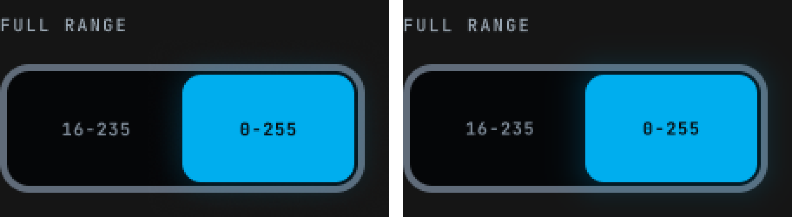

# figleaf

Figma-flavoured paint primitives and auto layout for small native Rust UIs.

You design a control in Figma. An agent (or you) reads the numbers off the
inspector and writes them down as figleaf calls, instead of hand-drawing
rounded rectangles, strokes and shadows again in every app. The host keeps its
own window, event loop, state and render pass; figleaf only answers "where does
this go" and "draw it the way Figma would".


That image is `cargo run --example switch --features wgpu,text-coretext`; its
design is made up for the example.

Three real controls have been checked against Figma so far, all written from
the values Figma reports. In each pair Figma's export is on the left and
figleaf is on the right.

The switch from the Abner design system ([examples/abner_switch.rs](examples/abner_switch.rs)),
enlarged 6x:


The ON/OFF switch from the same file ([examples/abner_onoff.rs](examples/abner_onoff.rs)),
enlarged 4x:


A segmented control from the Abner Timeline file ([examples/full_range.rs](examples/full_range.rs)),
enlarged 3x:



Fills, strokes, clips and layout land on the same pixels; shadows are within
4/255; curved edges are antialiased slightly differently; glyph edges differ
because Figma does not rasterize text with CoreText. What has and has not
been checked is in [TASKS.md](TASKS.md).

## Paint

```rust
use figleaf::{Canvas, Rect, Shadow, Shape, StrokeAlign, Text, hex, hexa};

let mut canvas = Canvas::new();
// Track: 44x24, corner radius 12, fill #34C759.
canvas.shape(Shape::rect(Rect::new(0., 0., 44., 24.)).radius(12.).fill(hex(0x34C759)));
// Knob: 20x20 ellipse, white, drop shadow X0 Y2 blur 4 at #000 20%.
canvas.shape(
    Shape::ellipse(Rect::new(22., 2., 20., 20.))
        .fill(hex(0xFFFFFF))
        .stroke(0.5, hexa(0x0000000A), StrokeAlign::Outside)
        .shadow(Shadow::drop(hexa(0x00000033), [0., 2.], 4.)),
);
canvas.text(Text::new("Sync to grid", Rect::new(56., 4., 120., 16.)).size(13., 16.));
```

| Figma | figleaf |
| --- | --- |
| Rectangle, corner radius, per-corner radii | `Shape::rect(..).radius(..)` / `.radii([tl, tr, br, bl])` |
| Ellipse | `Shape::ellipse(..)` |
| Fill (solid) | `.fill(hex(0xRRGGBB))`, `hexa(0xRRGGBBAA)` |
| Fill (linear gradient), paint opacity | `.gradient(LinearGradient::transform([a, b, tx]).stop(0., color).stop(1., color).opacity(0.5))` |
| Several fills | call `.fill(..)` / `.gradient(..)` once per fill, bottom first |
| Stroke, inside / center / outside | `.stroke(width, color, StrokeAlign::..)` |
| Drop shadow X, Y, blur, spread | `.shadow(Shadow::drop(color, [x, y], blur).spread(s))` |
| "Show behind transparent areas" | `.show_behind()` |
| Inner shadow | `.shadow(Shadow::inner(color, [x, y], blur))` |
| Clip content on a frame | `.clip(rect)` / `.clip_rounded(rect, radius)` |
| Text, size / line height, alignment | `Text::new(..).size(13., 16.).align(..)` |
| Letter spacing (pixels) | `.letter_spacing(0.7)` |
| Fixed-width text box, line breaks | `.wrap()`; `text::wrap(..)` gives the lines, for the height |
| Inner shadow on text | `.inner_shadow(color, [x, y], blur)` |

Colours are straight-alpha encoded sRGB, the numbers Figma shows.

## Layout

```rust
use figleaf::layout::{Align, Node, Sizing, Tree};

// A row: 12 padding, label left, switch right, centred vertically.
let mut tree = Tree::new(Node::row().padding(12.).align(Align::SpaceBetween, Align::Center));
let label = tree.add(tree.root(), Node::fixed([120., 16.]));
let switch = tree.add(tree.root(), Node::fixed([44., 24.]));

let solved = tree.solve([320., 48.])?;   // on every resize
let where_the_switch_goes = solved[switch];
```

Covers horizontal and vertical auto layout, wrapping (`.wrap(gap_between_lines)`),
padding, gap, alignment including space-between, fixed / hug / fill sizing, min
and max sizes, and absolutely positioned children. `solve_natural` sizes a hugging root to its content. Text
does not measure itself: ask the text backend for the advance and set the node.

## Drawing

With the `wgpu` feature the renderer draws inside the host's own render pass:

```rust
let mut renderer = figleaf::render::Renderer::new(&device, surface_format);
// when the UI changes:
let report = renderer.prepare(&device, &queue, &canvas, [width_px, height_px], scale, &mut text)?;
// in the host's pass:
renderer.draw(&mut pass);
```

A host that keeps its own ordered list of things to draw can call
`renderer.draw_items(&mut pass, range)` to put its drawing between ours.

An unchanged canvas uploads nothing and reports `changed: false`. Anything
that could not be drawn is listed by `renderer.problems()`; nothing is dropped
silently. A host on another renderer can call `Shape::layers` and draw the
coverage layers itself.

Text needs a backend. `text-coretext` (macOS, needs clang) rasterizes with
CoreText from font bytes you supply; `text::NoText` is for hosts with none.

## Features and dependencies

| Feature | Adds | Dependencies |
| --- | --- | --- |
| none | layout, display list, text types | none |
| `wgpu` | the renderer | wgpu 30 |
| `text-coretext` | CoreText text backend | system frameworks; clang and ar at build time |

## Not supported yet

Radial, angular and diamond gradients, gradients on strokes and text, more
than eight gradient stops, images, vectors, blurs, blend modes, clipped text
with rounded corners, drop shadows on text, flattened layer opacity, corner smoothing, multisampled targets, layout
grid, baseline alignment and space-between for wrapped lines, and for text: paragraph spacing, hyphenation, truncation, percentage letter spacing, mixed styles,
non-Latin scripts and any backend other than CoreText.

## Where it came from

figleaf is a sister of [figui](../figui), which tried to import whole Figma
frames into a runtime. figleaf keeps the parts that turned out to matter: the
auto layout solver and the CoreText text backend are borrowed from there; the
shape renderer is new.
