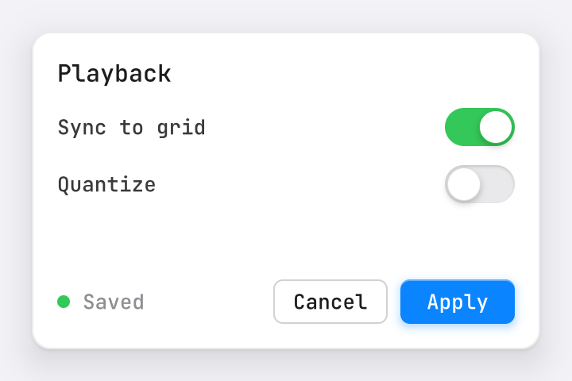

# figleaf

Figma-flavoured paint primitives and auto layout for small native Rust UIs.

You design a control or a panel in Figma. figleaf's Figma plugin turns the
selection into Rust that draws it, or an agent (or you) writes the same calls
by hand from the numbers in Figma's inspector. Either way the app stops
hand-drawing rounded rectangles, strokes, shadows and text. The host keeps its
own window, event loop, state and render pass; figleaf only answers "where does
this go" and "draw it the way Figma would".



That image is `cargo run --example switch --features wgpu,text-coretext`; its
design is made up for the example. Real controls drawn beside their Figma
exports are in the [reference](docs/REFERENCE.md#checked-beside-figma).

## Using figleaf in an app

### 1. Add the dependency

```toml
figleaf = { path = "../figleaf", features = ["wgpu", "text-coretext"] }
```

Leave out `text-coretext` if the app draws its own text and only wants shapes.

### 2. Get the drawing code

**Export it from Figma** (the usual way). Once, in Figma Desktop: Plugins →
Development → Import plugin from manifest, and choose
[plugin/manifest.json](plugin/manifest.json). Then select one frame or
component, run **figleaf — Rust**, click **Generate Rust** and copy the result.
The plugin only shows code: it writes no files and changes nothing in Figma.

Paste the code into its own module in the app, for example
`src/ui/toolbar.rs`. Treat it as generated: when the design changes, export
again and replace the file. Its comments carry each layer's name and Figma
node id.

**Or write it by hand.** For a small control, or a piece the plugin refuses,
write the calls yourself from Figma's values. The names follow the inspector:

```rust
use figleaf::{Canvas, Rect, Shadow, Shape, StrokeAlign, Text, hex, hexa};

let mut canvas = Canvas::new();
// Track: 44x24, corner radius 12, fill #34C759.
canvas.shape(Shape::rect(Rect::new(0., 0., 44., 24.)).radius(12.).fill(hex(0x34C759)));
// Knob: 20x20 ellipse, white, drop shadow X0 Y2 blur 4 at #000 20%.
canvas.shape(
    Shape::ellipse(Rect::new(22., 2., 20., 20.))
        .fill(hex(0xFFFFFF))
        .stroke(0.5, hexa(0x0000000A), StrokeAlign::Outside)
        .shadow(Shadow::drop(hexa(0x00000033), [0., 2.], 4.)),
);
canvas.text(Text::new("Sync to grid", Rect::new(56., 4., 120., 16.)).size(13., 16.));
```

[examples/switchblade_tags.rs](examples/switchblade_tags.rs) and
[examples/abner_button_bar.rs](examples/abner_button_bar.rs) are whole
controls written this way.

### 3. Call it

Exported code is one function, `draw_selection`, that adds the selection to
your `Canvas` with its top left at `(0, 0)`. What it asks for depends on what
was selected:

| The selection has | Signature |
| --- | --- |
| shapes only | `draw_selection(canvas)` |
| text | `draw_selection(canvas, fonts)` |
| auto layout | `draw_selection(canvas, size) -> Result` |
| auto layout with text that sets its own size | `draw_selection(canvas, size, fonts, backend) -> Result` |

- **`fonts`** is a list of indices into the fonts you gave the text backend.
  The top of the generated file says which font each slot needs, for example
  `// fonts[0]: JetBrains Mono / Regular`. Nothing is looked up on the system:
  you supply the font bytes and, for variable fonts, the axis values.
- **`size`** resizes the root. `Some([width, height])` lays the design out at
  that size, held to the root's min and max; `None` uses the size it has in
  Figma. Call it again with the new size when the window resizes. Where text
  sets its own size, each axis is separate: `[Some(320.), None]` fixes the
  width and lets the height follow the text.
- With auto layout the file also has `selection_layout(..)`, which returns the
  solved rectangles without drawing: use it for hit testing.

The selection always lands at the origin. There is no call yet to move a
whole exported piece, so export the frame that holds everything you want
placed together, or write the placement by hand.

### 4. Draw it

```rust
use figleaf::{Canvas, render::Renderer, text::{FontSource, coretext::CoreText}};

// Once.
let mut renderer = Renderer::new(&device, surface_format);
let mut text = CoreText::new(&[Some(FontSource { bytes: FONT, axes: &[] })])?;

// When the interface changes, or the window resizes.
let mut canvas = Canvas::new();
toolbar::draw_selection(&mut canvas, Some([width, 32.]))?;
let report = renderer.prepare(&device, &queue, &canvas, [width_px, height_px], scale, &mut text)?;

// Inside your own render pass, every frame.
renderer.draw(&mut pass);
```

- `prepare` takes the target size in physical pixels and `scale`, the physical
  pixels per Figma unit (2 on a Retina display).
- An unchanged canvas uploads nothing and `report.changed` is false, so the
  app can skip the redraw.
- An app with its own ordered list of things to draw calls
  `renderer.draw_items(&mut pass, range)` to put its drawing between
  figleaf's. Abner and Switchblade both do this.
- An app that draws no text through figleaf passes `&mut text::NoText`.
- Colours match Figma on a plain `Rgba8Unorm` or `Bgra8Unorm` target. On an
  `*Srgb` target translucent colours blend differently; write them as the
  opaque colour they make on their background.

### 5. Check it

After `prepare`, read `renderer.problems()`: anything that could not be drawn
is listed there by item, never dropped silently. Then look at the running app
beside Figma's own export of the same frame. The examples do this with
`support::compare`, which writes the two images side by side.

### When the plugin refuses

If any visible layer in the selection uses something the plugin cannot export,
it shows the layer's path and the reason and produces **no** code, so a
half-right export can't slip into an app. Then:

1. Look the reason up in the [plugin's limits](plugin/README.md).
2. Change that layer in Figma to something supported, or
3. Select a smaller hierarchy that leaves it out, and
4. Write the refused piece by hand as in step 2.

### What stays with the app

- **State.** An export is one snapshot. Hover, pressed, selected and disabled
  looks are separate exports (or hand-written variations) that the app
  switches between.
- **Changing text.** Exported strings are the ones in the design. For a label
  that changes at run time, give the generated function a parameter, or write
  that label by hand. A re-export will overwrite an edited file, so note the
  edit beside it.
- **Input.** Clicks, focus, keys and text editing. `text::caret_offsets` gives
  where a caret can stand in a line, for the app's own text field.
- **Variables and themes.** Figma variables are resolved to their values when
  you export; export again after changing them.

## Reference

- [docs/REFERENCE.md](docs/REFERENCE.md): every paint, text and layout feature,
  what the plugin exports for it, and how it was checked beside Figma.
- [plugin/README.md](plugin/README.md): the plugin's contract, limits and tests.
- [TASKS.md](TASKS.md): what is being worked on and what is not yet checked.

Running the plugin inside Figma Desktop end to end is still an open item in
TASKS.md; the steps above follow the plugin's own documentation and the
exports saved under `examples/generated`.

## Features and dependencies

| Feature | Adds | Dependencies |
| --- | --- | --- |
| none | layout, display list, text types | none |
| `wgpu` | the renderer | wgpu 30 |
| `text-coretext` | CoreText text backend | system frameworks; clang and ar at build time |

## Not supported yet

More than 64 gradient stops, image adjustments/animation, progressive blurs, multisampled targets, layout
grid, baseline alignment and space-between for wrapped lines, and for text: hyphenation,
color fonts, keycap emoji, explicit bidi controls, script-specific case conversion,
and any backend other than CoreText.

## Where it came from

figleaf is a sister of [figui](../figui), which tried to import whole Figma
frames into a runtime. figleaf keeps the parts that turned out to matter: the
auto layout solver and the CoreText text backend are borrowed from there; the
shape renderer is new.
